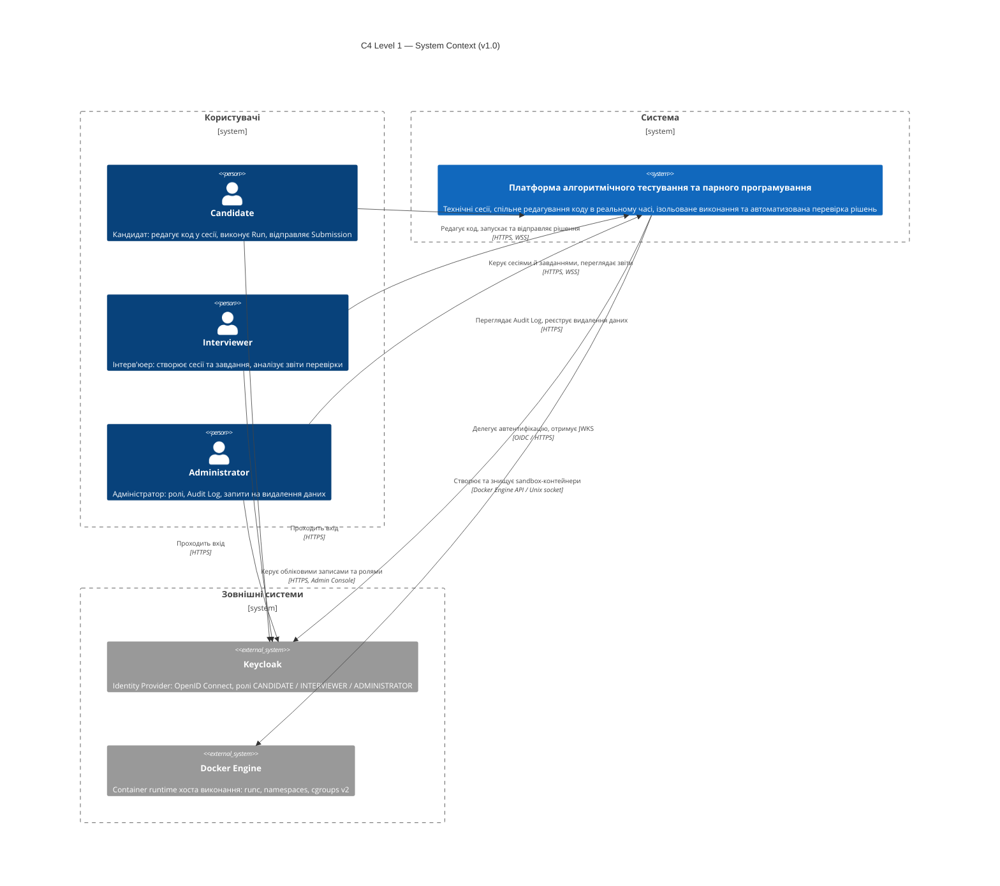
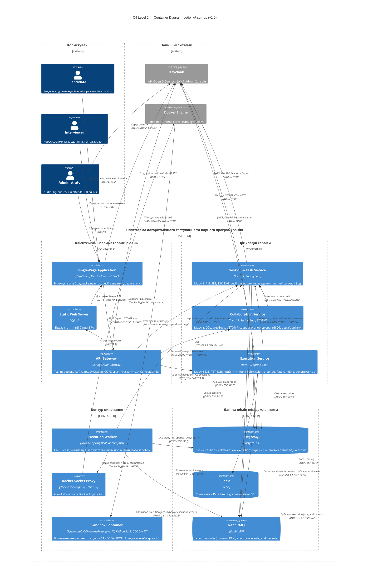
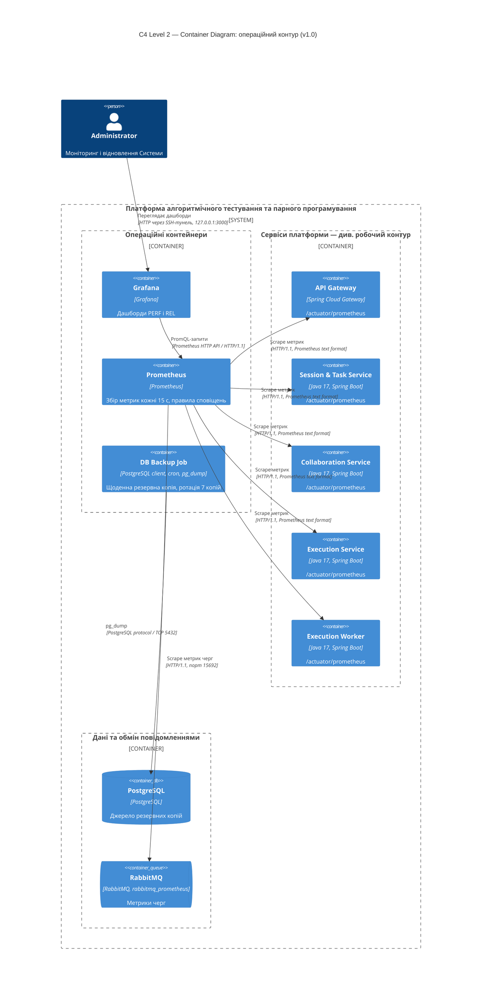
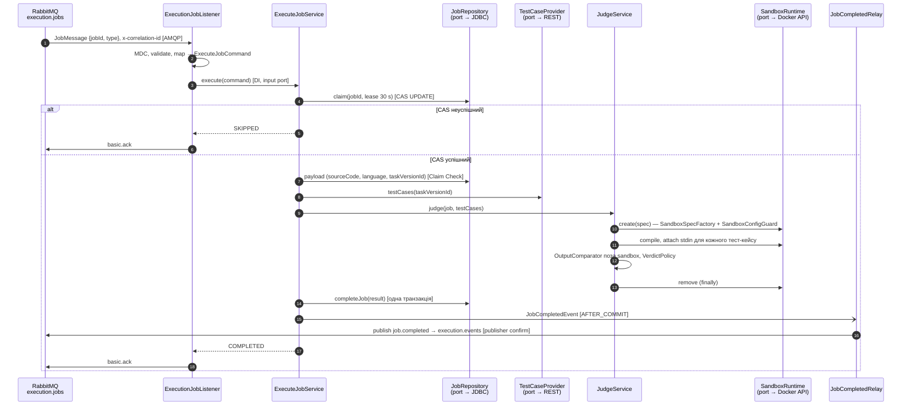

# Розділ 2. Проєктування архітектури системи

> Docs-as-Code: вимоги — [`srs.md`](./srs.md) (ISO/IEC/IEEE 29148, v1.3); архітектура — цей файл (C4 Model, рівні 1–3, Mermaid.js); рішення — [`adr/`](./adr/). Ідентифікатори вимог у тексті є відносними посиланнями на відповідні рядки `srs.md`.

| Підрозділ | Зміст |
|---|---|
| [2.1. C4: Context і Container](#diagram-level1) | [L1 System Context](#diagram-level1) · [L2 робочий контур](#diagram-level2) · [L2 операційний контур](#diagram-level2-ops) |
| [2.2. C4: Component — Execution Worker](#diagram-level3) | [L3 Component](#diagram-level3) · [Сценарій обробки Job](#diagram-sequence) |
| [2.3. Architecture Decision Records](#adr-index) | [ADR-001](./adr/0001-choice-of-technology.md) |
| [2.4. Наскрізне трасування](#traceability) | Вимоги → контейнери → компоненти → рішення |

---

## 2.1. Контекстне та контейнерне моделювання системи (C4 Model)

| Атрибут | Значення |
|---|---|
| Нотація | C4 Model (Simon Brown): рівень 1 — System Context, рівень 2 — Container |
| Формат | Diagrams-as-Code, Mermaid.js (`C4Context`, `C4Container`) |
| Базовий контракт вимог | [`srs.md`](./srs.md) v1.3 |
| Версія моделі | 1.1: v1.0 — після архітектурного рев'ю ARCH-01…ARCH-38; v1.1 — узгодження з компонентною моделлю Execution Worker (підрозділ 2.2): розподіл вимог TST між Execution Service і Worker, Claim Check у R-24 |
| Перевірка рендерингу | `@mermaid-js/mermaid-cli` 11.16.0: 3 діаграми, 0 синтаксичних помилок |
| Код діаграм | Вбудовано в цей файл (блоки `mermaid`); рендеринг — Markdown Preview GitHub |

**Позначення на схемах.** Підпис кожної стрілки має формат «призначення [протокол / транспорт]». Напрям стрілки — напрям залежності (ініціатор → отримувач); для AMQP ініціатором є клієнт брокера (publisher або consumer). Рівень 2 подано двома видами (views) однієї моделі: **робочий контур** (обробка запитів користувачів) та **операційний контур** (моніторинг, резервне копіювання). Обидва види використовують однакові ідентифікатори контейнерів.

---

<a name="diagram-level1"></a>

### 2.1.1. C4 Level 1 — System Context Diagram



**Актори (Person)**

| Актор | Роль у Системі | Канали доступу |
|---|---|---|
| Candidate | Приєднується до технічної сесії за запрошенням, редагує спільний документ, виконує Run, відправляє Submission | Браузер → Система (HTTPS, WSS); браузер → Keycloak (HTTPS, сторінка входу) |
| Interviewer | Створює сесії, завдання й тест-кейси, спостерігає за редагуванням, аналізує повний звіт перевірки | Браузер → Система (HTTPS, WSS); браузер → Keycloak (HTTPS) |
| Administrator | Переглядає Audit Log, реєструє запити на видалення даних, керує обліковими записами й ролями | Браузер → Система (HTTPS); Keycloak Admin Console (HTTPS) |

**Системи**

| Система | Тип | Призначення | Підстава в SRS |
|---|---|---|---|
| Платформа алгоритмічного тестування та парного програмування | Software System (у межах розробки) | Технічні сесії, спільне редагування, ізольоване виконання, автоматизована перевірка | розд. 1.2 |
| Keycloak | External System | Identity Provider: OpenID Connect, видача JWT, ключі JWKS, ролі, Admin Console | табл. 1.3-1; [SRS-DC-09](./srs.md#srs-dc-09); [SRS-IF-IDP-01](./srs.md#srs-if-idp-01) |
| Docker Engine | External System | Container runtime хоста виконання: створення sandbox-контейнерів (runc, namespaces, cgroups v2, seccomp) | табл. 1.3-1; [SRS-IF-DOCKER-01](./srs.md#srs-if-docker-01) |

**Зв'язки рівня 1**

| ID | Від → До | Призначення | Протокол |
|---|---|---|---|
| L1-01 | Candidate → Платформа | Редагування коду, Run, Submission, перегляд результатів | HTTPS (REST), WSS (STOMP 1.2) |
| L1-02 | Interviewer → Платформа | Керування сесіями та завданнями, перегляд звітів | HTTPS (REST), WSS (STOMP 1.2) |
| L1-03 | Administrator → Платформа | Перегляд Audit Log, реєстрація запитів на видалення даних | HTTPS (REST) |
| L1-04 | Candidate → Keycloak | Введення облікових даних на сторінці входу | HTTPS |
| L1-05 | Interviewer → Keycloak | Введення облікових даних на сторінці входу | HTTPS |
| L1-06 | Administrator → Keycloak | Керування обліковими записами та ролями | HTTPS (Keycloak Admin Console) |
| L1-07 | Платформа → Keycloak | Делегування автентифікації (Authorization Code + PKCE), отримання JWKS | OpenID Connect / HTTPS |
| L1-08 | Платформа → Docker Engine | Створення, запуск, зупинка та видалення sandbox-контейнерів | Docker Engine API / Unix socket (через docker-socket-proxy) |

PostgreSQL, Redis і RabbitMQ є контейнерами Системи і на рівні 1 не відображаються (див. [2.1.2](#diagram-level2)).

**Трасування рівня 1.** Межі Системи відповідають розд. 1.2 SRS (Scope), зовнішні сутності — табл. 1.3-1 SRS. Делегування автентифікації Keycloak реалізує [SRS-FUN-IAM-01](./srs.md#srs-fun-iam-01) і [SRS-IF-IDP-01](./srs.md#srs-if-idp-01); управління ролями поза Системою — [SRS-DC-09](./srs.md#srs-dc-09). Залежність від Docker Engine визначена [SRS-IF-DOCKER-01](./srs.md#srs-if-docker-01); вибір межі ізоляції для цієї залежності обґрунтовано в [ADR-001](./adr/0001-choice-of-technology.md).

---

<a name="diagram-level2"></a>

### 2.1.2. C4 Level 2 — Container Diagram: робочий контур



**Контейнери**

| Контейнер | Технологія | Відповідальність | Вимоги SRS | Мережевий інтерфейс |
|---|---|---|---|---|
| Single-Page Application | TypeScript, React, Monaco Editor | UI: редактор, сесії, завдання, результати; OIDC-клієнт (PKCE); STOMP-клієнт з автоперепідключенням | [SRS-IF-UI-01](./srs.md#srs-if-ui-01)…03; [SRS-FUN-COL-01](./srs.md#srs-fun-col-01); [SRS-NFR-REL-12](./srs.md#srs-nfr-rel-12); [SRS-NFR-CMP-04](./srs.md#srs-nfr-cmp-04) | Виконується в браузері |
| Static Web Server | Nginx | Віддає статичний бандл SPA | [SRS-IF-UI-01](./srs.md#srs-if-ui-01) | HTTP :80 (лише внутрішня мережа) |
| API Gateway | Spring Cloud Gateway | Єдина точка входу: TLS-термінація, перевірка JWT, маршрутизація, CORS, заголовки безпеки, ліміт тіла запиту 1 MiB, генерація `X-Correlation-Id`, блокування `/internal/**` | [SRS-FUN-IAM-02](./srs.md#srs-fun-iam-02); [SRS-NFR-SEC-04](./srs.md#srs-nfr-sec-04), 14, 15, 16; [SRS-NFR-MNT-04](./srs.md#srs-nfr-mnt-04) | HTTPS / WSS :443 (опублікований порт) |
| Session & Task Service | Java 17, Spring Boot | Профілі користувачів, сесії, запрошення, завдання та версії, тест-кейси, Audit Log (споживач `audit.events`), строки зберігання, видалення та експорт даних | [SRS-FUN-IAM-03](./srs.md#srs-fun-iam-03)…06; SES-01…10; TSK-01…06; DAT-01…09 | HTTP :8080 (внутрішня мережа) |
| Collaboration Service | Java 17, Spring Boot, Spring WebSocket (STOMP) | STOMP-endpoint, автентифікація CONNECT, авторизація SUBSCRIBE/SEND, серверно-впорядкований OT, ревізії, знімки, трансляція курсорів і результатів Run | [SRS-FUN-COL-02](./srs.md#srs-fun-col-02)…15; EXE-12; [SRS-DC-03](./srs.md#srs-dc-03), DC-04 | WS :8080 (внутрішня мережа) |
| Execution Service | Java 17, Spring Boot | Прийняття Run і Submission, валідація, реєстрація Execution Job, публікація з publisher confirms, Rate Limiting, реконсилятор станів Job, видача результатів із фільтрацією HIDDEN | [SRS-FUN-EXE-01](./srs.md#srs-fun-exe-01)…05, 11, 13; TST-01, 02, 12…14; JOB-01, 02, 07…17 | HTTP :8080 (внутрішня мережа) |
| Execution Worker | Java 17, Spring Boot, docker-java | Захоплення Job (CAS + lease), створення sandbox, компіляція, запуск тест-кейсів через stdin, порівняння результатів поза sandbox, визначення вердиктів, запис результату, очищення контейнерів; компонентна модель — підрозділ 2.2 | [SRS-FUN-EXE-06](./srs.md#srs-fun-exe-06)…10, 14, 15; TST-03…11; JOB-03…06 | HTTP :8080 (лише `/actuator`) |
| Docker Socket Proxy | docker-socket-proxy (HAProxy) | Allowlist викликів Docker Engine API; єдиний контейнер зі змонтованим `/var/run/docker.sock` | [SRS-NFR-SEC-07](./srs.md#srs-nfr-sec-07); [SRS-IF-DOCKER-01](./srs.md#srs-if-docker-01) | HTTP :2375 (лише мережа `exec-net`) |
| Sandbox Container | Ефемерний OCI-контейнер; образи Java 17, Python 3.12, GCC (C++17) | Компіляція й виконання недовіреного коду одного Job за SANDBOX-PROFILE | [SRS-FUN-EXE-06](./srs.md#srs-fun-exe-06); [табл. 2.3-2](./srs.md#table-2-3-2); [SRS-NFR-SEC-06](./srs.md#srs-nfr-sec-06), 08; [SRS-DC-05](./srs.md#srs-dc-05), DC-07 | Мережа вимкнена (`--network none`) |
| PostgreSQL | PostgreSQL | Схеми `sessions`, `collaboration`, `execution`; окремий обліковий запис БД на сервіс; Flyway-міграції | розд. 2.4; [SRS-DC-06](./srs.md#srs-dc-06), DC-11; [SRS-NFR-MNT-02](./srs.md#srs-nfr-mnt-02) | TCP :5432 (внутрішня мережа) |
| Redis | Redis | Лічильники Rate Limiting (ковзне вікно 60 с) | [SRS-FUN-JOB-12](./srs.md#srs-fun-job-12), 13 | TCP :6379 (внутрішня мережа) |
| RabbitMQ | RabbitMQ | `execution.direct` → `execution.jobs` (quorum, `x-delivery-limit` = 3, DLX → `execution.jobs.dlq`); topic `execution.events`; topic `audit.events` | [SRS-IF-AMQP-01](./srs.md#srs-if-amqp-01)…03; [SRS-DC-08](./srs.md#srs-dc-08) | AMQP :5672; метрики :15692 |

**Зв'язки робочого контуру**

| ID | Від → До | Призначення | Протокол / транспорт | Взаємодія | SRS |
|---|---|---|---|---|---|
| R-01 | Candidate → SPA | Редагування коду, Run, Submission | HTTPS, WSS (браузер) | — | [SRS-IF-UI-01](./srs.md#srs-if-ui-01) |
| R-02 | Interviewer → SPA | Керування сесіями та завданнями, звіти | HTTPS, WSS (браузер) | — | [SRS-IF-UI-01](./srs.md#srs-if-ui-01) |
| R-03 | Administrator → SPA | Перегляд Audit Log, запити на видалення | HTTPS (браузер) | — | [SRS-FUN-DAT-04](./srs.md#srs-fun-dat-04), 07 |
| R-04 | Administrator → Keycloak | Керування ролями | HTTPS, Keycloak Admin Console | Синхронна | [SRS-DC-09](./srs.md#srs-dc-09) |
| R-05 | SPA → Keycloak | Вхід: Authorization Code + PKCE (S256), оновлення токенів | OpenID Connect / HTTPS | Синхронна | [SRS-FUN-IAM-01](./srs.md#srs-fun-iam-01); [SRS-NFR-SEC-01](./srs.md#srs-nfr-sec-01), 02 |
| R-06 | SPA → API Gateway | Виклики `/api/v1/**`; STOMP-кадри `/ws` | JSON / HTTPS (REST); STOMP 1.2 / WSS | Синхронна; двонаправлений потік | [SRS-IF-API-01](./srs.md#srs-if-api-01); [SRS-IF-WS-01](./srs.md#srs-if-ws-01) |
| R-07 | API Gateway → Static Web Server | Проксіювання статичних ресурсів `/` | HTTP/1.1 | Синхронна | [SRS-IF-UI-01](./srs.md#srs-if-ui-01) |
| R-08 | Static Web Server → SPA | Доставка JS/CSS-бандла в браузер | HTTPS (через API Gateway) | Синхронна | [SRS-IF-UI-01](./srs.md#srs-if-ui-01) |
| R-09 | API Gateway → Keycloak | OIDC Discovery, отримання JWKS для перевірки JWT | HTTP (внутрішня мережа) | Синхронна, кешування ключів | [SRS-IF-IDP-01](./srs.md#srs-if-idp-01); [SRS-NFR-SEC-03](./srs.md#srs-nfr-sec-03) |
| R-10 | API Gateway → Session & Task Service | Маршрути `/api/v1/sessions`, `/tasks`, `/audit`, `/users` | REST, JSON / HTTP/1.1 | Синхронна | SRS-FUN-SES, TSK, DAT |
| R-11 | API Gateway → Execution Service | Маршрути `/api/v1/executions`, `/submissions` | REST, JSON / HTTP/1.1 | Синхронна | [SRS-FUN-EXE-01](./srs.md#srs-fun-exe-01)…04, TST-01 |
| R-12 | API Gateway → Collaboration Service | Проксіювання `/ws` | STOMP 1.2 / WebSocket (HTTP Upgrade) | Двонаправлений потік | [SRS-FUN-COL-02](./srs.md#srs-fun-col-02) |
| R-13 | Collaboration Service → Keycloak | JWKS для перевірки токена в кадрі STOMP CONNECT | JWKS / HTTP | Синхронна, кешування ключів | [SRS-FUN-COL-03](./srs.md#srs-fun-col-03), 05 |
| R-14 | Session & Task Service → Keycloak | JWKS: сервіс працює як OAuth2 Resource Server | JWKS / HTTP | Синхронна, кешування ключів | [SRS-FUN-IAM-03](./srs.md#srs-fun-iam-03), 04 |
| R-15 | Execution Service → Keycloak | JWKS: сервіс працює як OAuth2 Resource Server | JWKS / HTTP | Синхронна, кешування ключів | [SRS-FUN-IAM-03](./srs.md#srs-fun-iam-03), 04 |
| R-16 | Collaboration Service → Session & Task Service | Перевірка членства та стану сесії | REST, JSON / HTTP/1.1, `/internal` | Синхронна | [SRS-FUN-COL-04](./srs.md#srs-fun-col-04); SES-08 |
| R-17 | Execution Service → Session & Task Service | Перевірка членства, стану сесії, версії завдання | REST, JSON / HTTP/1.1, `/internal` | Синхронна | [SRS-FUN-IAM-05](./srs.md#srs-fun-iam-05); SES-09; TST-01 |
| R-18 | Execution Worker → Session & Task Service | Отримання тест-кейсів версії завдання (`input`, `expectedOutput`) | REST, JSON / HTTP/1.1, `/internal` | Синхронна | [SRS-FUN-TST-03](./srs.md#srs-fun-tst-03)…05 |
| R-19 | Session & Task Service → PostgreSQL | Читання/запис схеми `sessions` | JDBC / PostgreSQL wire protocol, TCP 5432 | Синхронна | розд. 2.4 |
| R-20 | Collaboration Service → PostgreSQL | Операції, ревізії, знімки (схема `collaboration`) | JDBC / TCP 5432 | Синхронна | [SRS-FUN-COL-06](./srs.md#srs-fun-col-06), 12, 13 |
| R-21 | Execution Service → PostgreSQL | Execution Job, Submission, результати (схема `execution`) | JDBC / TCP 5432 | Синхронна | [SRS-FUN-EXE-04](./srs.md#srs-fun-exe-04); JOB-01, 02 |
| R-22 | Execution Worker → PostgreSQL | CAS-переходи стану Job, оренда, запис результатів (схема `execution`) | JDBC / TCP 5432 | Синхронна | [SRS-FUN-JOB-02](./srs.md#srs-fun-job-02)…06; TST-10 |
| R-23 | Execution Service → Redis | Перевірка та інкремент лічильника Rate Limiting | RESP / TCP 6379 | Синхронна | [SRS-FUN-JOB-12](./srs.md#srs-fun-job-12), 13 |
| R-24 | Execution Service → RabbitMQ | Публікація `execution.jobs` (Claim Check: лише `jobId`, `type`; publisher confirms) і `audit.events` | AMQP 0-9-1 / TCP 5672 | Асинхронна | [SRS-FUN-EXE-05](./srs.md#srs-fun-exe-05); JOB-09 |
| R-25 | Execution Worker → RabbitMQ | Споживання `execution.jobs` (manual ack, prefetch = `worker.max-parallel`); публікація `execution.events` | AMQP 0-9-1 / TCP 5672 | Асинхронна | [SRS-FUN-JOB-04](./srs.md#srs-fun-job-04), 06, 11; [SRS-IF-AMQP-03](./srs.md#srs-if-amqp-03) |
| R-26 | Collaboration Service → RabbitMQ | Споживання `execution.events`; публікація `audit.events` | AMQP 0-9-1 / TCP 5672 | Асинхронна | [SRS-FUN-EXE-12](./srs.md#srs-fun-exe-12); DAT-02 |
| R-27 | Session & Task Service → RabbitMQ | Споживання `audit.events` | AMQP 0-9-1 / TCP 5672 | Асинхронна | [SRS-FUN-DAT-02](./srs.md#srs-fun-dat-02), 03 |
| R-28 | Execution Worker → Docker Socket Proxy | Створення, запуск, очікування, зупинка, видалення sandbox; потоки stdin/stdout/stderr (attach) | Docker Engine API / HTTP, TCP 2375 | Синхронна; потоковий обмін | [SRS-FUN-EXE-06](./srs.md#srs-fun-exe-06), 14, 15 |
| R-29 | Docker Socket Proxy → Docker Engine | Передача лише дозволених викликів | Docker Engine API / Unix socket | Синхронна | [SRS-NFR-SEC-07](./srs.md#srs-nfr-sec-07) |
| R-30 | Docker Engine → Sandbox Container | Створення контейнера з обмеженнями SANDBOX-PROFILE | runc: namespaces, cgroups v2, seccomp | — | [табл. 2.3-2](./srs.md#table-2-3-2) |

**Трасування рівня 2 (ключові ланцюжки «вимога → контейнер → рішення»).**

- Контейнер **API Gateway** [C4 Container](#diagram-level2) реалізує перевірку токена [SRS-FUN-IAM-02](./srs.md#srs-fun-iam-02), транспортне шифрування [SRS-NFR-SEC-04](./srs.md#srs-nfr-sec-04), ліміти вхідних повідомлень [SRS-NFR-SEC-14](./srs.md#srs-nfr-sec-14) і блокування внутрішніх маршрутів [SRS-NFR-SEC-16](./srs.md#srs-nfr-sec-16).
- Контейнер **Collaboration Service** [C4 Container](#diagram-level2) реалізує модуль спільного редагування [SRS-FUN-COL-01](./srs.md#srs-fun-col-01)…15 за алгоритмом [SRS-DC-03](./srs.md#srs-dc-03) і в межах обмеження розгортання [SRS-DC-04](./srs.md#srs-dc-04); авторизація STOMP-кадрів — [SRS-FUN-COL-04](./srs.md#srs-fun-col-04).
- Контейнер **Execution Service** [C4 Container](#diagram-level2) реалізує прийняття запусків [SRS-FUN-EXE-01](./srs.md#srs-fun-exe-01)…05, Rate Limiting [SRS-FUN-JOB-12](./srs.md#srs-fun-job-12) і реконсилятор станів [SRS-FUN-JOB-07](./srs.md#srs-fun-job-07)…10, 16, 17; публікація за патерном Claim Check — [SRS-IF-AMQP-02](./srs.md#srs-if-amqp-02).
- Контейнер **Execution Worker** [C4 Container](#diagram-level2) реалізує ізольоване виконання [SRS-FUN-EXE-06](./srs.md#srs-fun-exe-06) з профілем [табл. 2.3-2](./srs.md#table-2-3-2) і базується на рішенні [ADR-001](./adr/0001-choice-of-technology.md) щодо межі ізоляції (runc / gVisor); внутрішню будову наведено на [C4 Component](#diagram-level3).
- Контейнер **Docker Socket Proxy** [C4 Container](#diagram-level2) реалізує [SRS-NFR-SEC-07](./srs.md#srs-nfr-sec-07); **Sandbox Container** — [SRS-NFR-SEC-06](./srs.md#srs-nfr-sec-06) і [SRS-NFR-SEC-08](./srs.md#srs-nfr-sec-08) з runtime за [SRS-DC-07](./srs.md#srs-dc-07) і [ADR-001](./adr/0001-choice-of-technology.md).
- Контейнери **PostgreSQL**, **Redis**, **RabbitMQ** реалізують логічну модель даних [табл. 2.4-1](./srs.md#table-2-4-1), строки зберігання [табл. 2.4-2](./srs.md#table-2-4-2) і контракт обміну [SRS-IF-AMQP-01](./srs.md#srs-if-amqp-01) з налаштуваннями [SRS-DC-08](./srs.md#srs-dc-08).

---

<a name="diagram-level2-ops"></a>

### 2.1.3. C4 Level 2 — Container Diagram: операційний контур



**Контейнери операційного контуру**

| Контейнер | Технологія | Відповідальність | Вимоги SRS | Мережевий інтерфейс |
|---|---|---|---|---|
| Prometheus | Prometheus | Збір метрик сервісів і RabbitMQ кожні 15 с; правила сповіщень | [SRS-NFR-MNT-05](./srs.md#srs-nfr-mnt-05); [SRS-NFR-REL-01](./srs.md#srs-nfr-rel-01) | HTTP :9090 (внутрішня мережа) |
| Grafana | Grafana | Дашборди метрик PERF і REL | [SRS-NFR-MNT-05](./srs.md#srs-nfr-mnt-05); розд. 3.2 | HTTP :3000, прив'язка до 127.0.0.1 |
| DB Backup Job | PostgreSQL client, cron, `pg_dump` | Щоденна резервна копія БД на окремий том, ротація 7 копій | [SRS-NFR-REL-08](./srs.md#srs-nfr-rel-08), REL-09 | Вихідні з'єднання до PostgreSQL |

**Зв'язки операційного контуру**

| ID | Від → До | Призначення | Протокол / транспорт | SRS |
|---|---|---|---|---|
| O-01 | Administrator → Grafana | Перегляд дашбордів | HTTP через SSH-тунель (127.0.0.1:3000) | [SRS-NFR-MNT-05](./srs.md#srs-nfr-mnt-05) |
| O-02 | Grafana → Prometheus | PromQL-запити | Prometheus HTTP API / HTTP/1.1 | [SRS-NFR-MNT-05](./srs.md#srs-nfr-mnt-05) |
| O-03…O-07 | Prometheus → API Gateway, Session & Task, Collaboration, Execution Service, Execution Worker | Scrape `/actuator/prometheus` | HTTP/1.1, Prometheus text exposition format | [SRS-NFR-MNT-05](./srs.md#srs-nfr-mnt-05) |
| O-08 | Prometheus → RabbitMQ | Метрики черг (плагін `rabbitmq_prometheus`) | HTTP/1.1, TCP 15692 | [SRS-NFR-PERF-06](./srs.md#srs-nfr-perf-06) |
| O-09 | DB Backup Job → PostgreSQL | `pg_dump` за розкладом | PostgreSQL wire protocol / TCP 5432 | [SRS-NFR-REL-08](./srs.md#srs-nfr-rel-08) |

Журнали всіх контейнерів записуються у stdout у форматі JSON ([SRS-NFR-MNT-03](./srs.md#srs-nfr-mnt-03)) і зберігаються драйвером Docker `json-file` з ротацією 14 днів ([табл. 2.4-2](./srs.md#table-2-4-2)); окремий контейнер агрегування журналів у v1.0 не передбачено.

**Трасування операційного контуру.** Prometheus і Grafana [C4 Container](#diagram-level2-ops) реалізують [SRS-NFR-MNT-05](./srs.md#srs-nfr-mnt-05) і вимірювання доступності [SRS-NFR-REL-01](./srs.md#srs-nfr-rel-01); DB Backup Job — резервне копіювання [SRS-NFR-REL-08](./srs.md#srs-nfr-rel-08) і відновлення [SRS-NFR-REL-09](./srs.md#srs-nfr-rel-09). Обмеження Actuator — [SRS-NFR-SEC-18](./srs.md#srs-nfr-sec-18).

---

### 2.1.4. Трасування SRS → контейнери

| Модуль / вимога SRS | Контейнери |
|---|---|
| IAM ([SRS-FUN-IAM-01](./srs.md#srs-fun-iam-01)…06) | SPA (OIDC-клієнт), API Gateway (IAM-02), Session & Task Service та Execution Service (IAM-03…05 як Resource Server), Session & Task Service (IAM-06), Keycloak (зовнішня система) |
| SES ([SRS-FUN-SES-01](./srs.md#srs-fun-ses-01)…10) | Session & Task Service; Collaboration Service (SES-08 — режим лише читання) |
| COL ([SRS-FUN-COL-01](./srs.md#srs-fun-col-01)…15) | SPA (COL-01), Collaboration Service (COL-02…15), PostgreSQL (схема `collaboration`) |
| TSK ([SRS-FUN-TSK-01](./srs.md#srs-fun-tsk-01)…06) | Session & Task Service |
| EXE ([SRS-FUN-EXE-01](./srs.md#srs-fun-exe-01)…15) | Execution Service (EXE-01…05, 11, 13), Execution Worker (EXE-06…10, 14, 15), Collaboration Service (EXE-12), Docker Socket Proxy, Sandbox Container |
| TST ([SRS-FUN-TST-01](./srs.md#srs-fun-tst-01)…14) | Execution Service (TST-01, 02, 12…14), Execution Worker (TST-03…11), Session & Task Service (джерело тест-кейсів) |
| JOB ([SRS-FUN-JOB-01](./srs.md#srs-fun-job-01)…17) | Execution Service (реконсилятор JOB-07…10, 16, 17, Rate Limiting JOB-12…14, JOB-15), Execution Worker (JOB-03…06), RabbitMQ (JOB-11), Redis (JOB-12) |
| DAT ([SRS-FUN-DAT-01](./srs.md#srs-fun-dat-01)…09) | Session & Task Service (Audit Log, строки зберігання, видалення, експорт); Execution Service (історія Job, DAT-01) |
| [SRS-NFR-SEC-04](./srs.md#srs-nfr-sec-04), 14, 15, 16 | API Gateway |
| [SRS-NFR-SEC-06](./srs.md#srs-nfr-sec-06)…08 | Docker Socket Proxy, Sandbox Container, Execution Worker |
| [SRS-NFR-MNT-04](./srs.md#srs-nfr-mnt-04), 05 | API Gateway (Correlation ID), усі Spring-сервіси (метрики), Prometheus, Grafana |
| [SRS-NFR-REL-08](./srs.md#srs-nfr-rel-08), 09 | DB Backup Job, PostgreSQL |

Усі 8 функціональних модулів SRS мають щонайменше один контейнер-власник; контейнерів без вимог SRS немає.

---

### 2.1.5. Архітектурні рішення рівня контейнерів

| ID | Рішення | Обґрунтування / SRS |
|---|---|---|
| AD-01 | API Gateway — єдина точка входу HTTPS/WSS; опубліковано лише порт 443. Маршрути `/internal/**` ззовні не обслуговуються. | [SRS-NFR-SEC-04](./srs.md#srs-nfr-sec-04), SEC-16; [SRS-DC-10](./srs.md#srs-dc-10) |
| AD-02 | JWT перевіряється на API Gateway та повторно в сервісах (OAuth2 Resource Server); токен WebSocket-сесії перевіряє Collaboration Service у кадрі STOMP CONNECT, оскільки Gateway не розбирає STOMP-кадри. | [SRS-FUN-IAM-02](./srs.md#srs-fun-iam-02)…04; COL-03…05 |
| AD-03 | Один екземпляр PostgreSQL зі схемою на сервіс і окремими обліковими записами БД. Execution Service і Execution Worker утворюють один bounded context і спільно використовують схему `execution`. | Табл. 2.4-1; [SRS-DC-11](./srs.md#srs-dc-11) |
| AD-04 | Виконання коду — асинхронне: Execution Service → RabbitMQ → Worker. Результат Run доставляється клієнтам подією `execution.events` через Collaboration Service; `GET /executions/{jobId}` — резервний канал. | [SRS-FUN-EXE-04](./srs.md#srs-fun-exe-04), 05, 12, 13 |
| AD-05 | Worker не має прямого доступу до Docker socket; взаємодія — через docker-socket-proxy з allowlist. Sandbox-контейнер одноразовий, без мережі. | [SRS-NFR-SEC-06](./srs.md#srs-nfr-sec-06), SEC-07 |
| AD-06 | OT виконується всередині процесу Collaboration Service (компонент, а не контейнер); сервіс розгортається одним екземпляром. | [SRS-DC-03](./srs.md#srs-dc-03), DC-04 |
| AD-07 | Тест-кейси (зокрема HIDDEN) Worker отримує внутрішнім REST-викликом і не передає `expectedOutput` у sandbox. | [SRS-FUN-TST-04](./srs.md#srs-fun-tst-04), 05 |
| AD-08 | Рівень 2 подано двома видами (робочий і операційний контур) для читабельності при 30 + 9 зв'язках. | Рев'ю ARCH-19 |

---

## 2.2. Компонентне моделювання критичного сервісу системи (C4 Model: Component)

| Атрибут | Значення |
|---|---|
| Обраний контейнер | **Execution Worker** ([C4 Level 2](#diagram-level2)) |
| Технології | Java 17, Spring Boot, Spring AMQP, Spring JdbcClient, docker-java, Resilience4j, Micrometer, MapStruct, Jakarta Bean Validation |
| Архітектурний стиль | Clean Architecture / Ports & Adapters (Hexagonal) |
| Нотація | C4 Level 3; Mermaid.js `flowchart` зі стилями C4 (обґрунтування — 2.2.6) |
| Базові артефакти | [`srs.md`](./srs.md) v1.3; [C4 Container](#diagram-level2) v1.1; [ADR-001](./adr/0001-choice-of-technology.md) |
| Версія моделі | 1.0 (після аудиту COMP-01…COMP-34) |
| Перевірка рендерингу | `@mermaid-js/mermaid-cli` 11.16.0 і Mermaid 11 у Chromium (екран 1920 px): 0 синтаксичних помилок |

**Обґрунтування вибору.** Execution Worker виконує основне обчислювальне навантаження Системи і є точкою реалізації ключової інженерної проблеми роботи — безпечного виконання недовіреного коду (загроза Remote Code Execution). У контейнері зосереджено вимоги SRS з найвищою критичністю: ізоляція sandbox ([SRS-NFR-SEC-06](./srs.md#srs-nfr-sec-06)…08, [табл. 2.3-2](./srs.md#table-2-3-2)), ідемпотентна обробка повідомлень і оренда Job ([SRS-FUN-JOB-03](./srs.md#srs-fun-job-03)…06, [SRS-NFR-REL-02](./srs.md#srs-nfr-rel-02)), конфіденційність прихованих тест-кейсів ([SRS-FUN-TST-04](./srs.md#srs-fun-tst-04), TST-05), ліміти ресурсів і виводу ([SRS-FUN-EXE-07](./srs.md#srs-fun-exe-07)…10). Відмова або вразливість цього контейнера безпосередньо порушує цілісність оцінювання кандидатів і безпеку хоста.

---

<a name="diagram-level3"></a>

### 2.2.1. Діаграма компонентів

```mermaid
---
title: C4 Level 3 — Component Diagram — Execution Worker (v1.0)
---
flowchart TB
  %% ---------- Зовнішні контейнери: вхідні ----------
  rabbitIn[("<b>RabbitMQ</b><br/><i>[Container: RabbitMQ]</i><br/>queue execution.jobs")]
  prom["<b>Prometheus</b><br/><i>[Container: Prometheus]</i><br/>Scrape кожні 15 с"]

  subgraph W["Execution Worker — [Container: Java 17, Spring Boot]"]
    direction TB

    subgraph IN["Inbound adapters"]
      listener["<b>ExecutionJobListener</b><br/><i>[Spring AMQP @RabbitListener]</i><br/>Manual ack; concurrency =<br/>worker.max-parallel (Bulkhead)"]
      corr["<b>CorrelationIdAdvice</b><br/><i>[AOP advice chain, SLF4J MDC]</i><br/>x-correlation-id, jobId → MDC"]
      validator["<b>JobMessageValidator</b><br/><i>[Jakarta Bean Validation]</i><br/>Схема повідомлення Claim Check"]
      mapper["<b>JobMessageMapper</b><br/><i>[MapStruct]</i><br/>JobMessage DTO → ExecuteJobCommand"]
      errhandler["<b>ListenerErrorHandler</b><br/><i>[RabbitListenerErrorHandler]</i><br/>Неперехоплені винятки → reject у DLQ"]
      actuator["<b>Actuator Endpoints</b><br/><i>[Spring Boot Actuator]</i><br/>Лише /health, /prometheus"]
    end

    subgraph APP["Application layer"]
      usecase["<b>ExecuteJobUseCase</b><br/><i>[Java interface — input port]</i><br/>execute(ExecuteJobCommand)"]
      orchestrator["<b>ExecuteJobService</b><br/><i>[Application Service]</i><br/>claim → тест-кейси → judge → completeJob"]
      judge["<b>JudgeService</b><br/><i>[Application Service]</i><br/>Компіляція, запуск тест-кейсів через stdin"]
      heartbeat["<b>LeaseHeartbeatScheduler</b><br/><i>[Spring @Scheduled]</i><br/>Продовження оренди кожні 10 с"]
      reaper["<b>OrphanSandboxReaper</b><br/><i>[@Scheduled, ApplicationReadyEvent]</i><br/>Очищення осиротілих sandbox"]
      relay["<b>JobCompletedRelay</b><br/><i>[@TransactionalEventListener AFTER_COMMIT]</i><br/>Публікація події після коміту"]
      metrics["<b>ExecutionMetrics</b><br/><i>[Micrometer Observation API]</i><br/>Етапи, вердикти, inflight"]
    end

    subgraph DOM["Domain core — без залежностей від фреймворків"]
      job["<b>ExecutionJob</b><br/><i>[Aggregate Root]</i><br/>Стани JOB-01, оренда, attempt"]
      verdict["<b>VerdictPolicy</b><br/><i>[Domain Service]</i><br/>Вердикти TST-07, агрегація TST-08/09"]
      comparator["<b>OutputComparator</b><br/><i>[Strategy]</i><br/>Нормалізація TST-06"]
      lang["<b>LanguageRegistry</b><br/><i>[Domain Service, Value Objects]</i><br/>Мова → образ, команди, ліміти"]
      policy["<b>SandboxPolicy</b><br/><i>[Value Object]</i><br/>Параметри SANDBOX-PROFILE"]
    end

    subgraph PORTS["Output ports — інтерфейси, що належать ядру"]
      jobPort["<b>JobRepository</b><br/><i>[Java interface]</i><br/>claim, renewLease, releaseLease,<br/>completeJob, findProcessing"]
      testPort["<b>TestCaseProvider</b><br/><i>[Java interface]</i><br/>testCases(taskVersionId)"]
      sandboxPort["<b>SandboxRuntime</b><br/><i>[Java interface]</i><br/>create, start, attach, wait,<br/>kill, remove, listByLabel"]
      eventPort["<b>ExecutionEventPublisher</b><br/><i>[Java interface]</i><br/>publish(JobCompleted)"]
    end

    subgraph OUT["Outbound adapters"]
      jdbc["<b>JdbcJobRepositoryAdapter</b><br/><i>[Spring JdbcClient, RowMapper]</i><br/>CAS UPDATE … WHERE state = ?"]
      testClient["<b>SessionTestCaseClient</b><br/><i>[Spring RestClient, Resilience4j]</i><br/>Timeout 2 с, retry 3, circuit breaker"]
      dockerAdapter["<b>DockerSandboxAdapter</b><br/><i>[docker-java, Apache HttpClient 5]</i><br/>Docker Engine API; timeouts"]
      specFactory["<b>SandboxSpecFactory</b><br/><i>[Factory]</i><br/>SandboxPolicy + LanguageProfile → HostConfig"]
      guard["<b>SandboxConfigGuard</b><br/><i>[Guard, fail-closed]</i><br/>Звірка HostConfig з SANDBOX-PROFILE"]
      collector["<b>BoundedOutputCollector</b><br/><i>[docker-java ResultCallback]</i><br/>stdout/stderr ≤ 64 KiB"]
      amqpPub["<b>AmqpEventPublisherAdapter</b><br/><i>[Spring AMQP RabbitTemplate]</i><br/>Publisher confirms"]
      logging["<b>Structured Logging</b><br/><i>[Logback, logstash-encoder]</i><br/>JSON; маскування sourceCode і токенів"]
    end
  end

  %% ---------- Зовнішні контейнери: вихідні ----------
  postgres[("<b>PostgreSQL</b><br/><i>[Container: PostgreSQL]</i><br/>Схема execution")]
  session["<b>Session & Task Service</b><br/><i>[Container: Java 17, Spring Boot]</i><br/>/internal/task-versions/{id}/test-cases"]
  proxy["<b>Docker Socket Proxy</b><br/><i>[Container: docker-socket-proxy]</i><br/>Allowlist Docker Engine API"]
  sandbox["<b>Sandbox Container</b><br/><i>[Container: ефемерний OCI]</i><br/>Недовірений код, SANDBOX-PROFILE"]
  rabbitOut[("<b>RabbitMQ</b><br/><i>[Container: RabbitMQ]</i><br/>exchange execution.events")]

  %% ---------- Inbound ----------
  rabbitIn -->|"Доставляє JobMessage<br/>[AMQP 0-9-1, manual ack]"| listener
  prom -->|"Scrape /actuator/prometheus<br/>[HTTP/1.1]"| actuator
  listener -->|"Обгортається<br/>[Spring AOP advice chain]"| corr
  listener -->|"validate(message)<br/>[DI, jakarta.validation.Validator]"| validator
  listener -->|"toCommand(dto)<br/>[DI, виклик методу]"| mapper
  listener -->|"Неперехоплені винятки<br/>[Spring AMQP error handler]"| errhandler
  listener -->|"execute(command)<br/>[DI, виклик інтерфейсу]"| usecase
  errhandler -->|"Журналює з MDC<br/>[SLF4J]"| logging
  actuator -->|"Експонує MeterRegistry<br/>[Micrometer]"| metrics

  %% ---------- Application ----------
  usecase -.->|"реалізується<br/>[implements]"| orchestrator
  orchestrator -->|"claim, complete, releaseLease<br/>[виклик методів агрегату]"| job
  orchestrator -->|"Захоплення та фіксація Job<br/>[DI, output port]"| jobPort
  orchestrator -->|"Тест-кейси версії завдання<br/>[DI, output port]"| testPort
  orchestrator -->|"judge(job, testCases)<br/>[DI, виклик методу]"| judge
  orchestrator -->|"JobCompletedEvent<br/>[Observer: ApplicationEventPublisher]"| relay
  orchestrator -->|"Спостереження етапів<br/>[Micrometer Observation]"| metrics
  judge -->|"Керування sandbox<br/>[DI, output port]"| sandboxPort
  judge -->|"Профіль мови<br/>[виклик методу]"| lang
  judge -->|"stdout vs expectedOutput<br/>[Strategy, виклик інтерфейсу]"| comparator
  judge -->|"Вердикти<br/>[виклик методу]"| verdict
  heartbeat -->|"renewLease<br/>[DI, output port]"| jobPort
  reaper -->|"findProcessing<br/>[DI, output port]"| jobPort
  reaper -->|"listByLabel, remove<br/>[DI, output port]"| sandboxPort
  relay -->|"publish(JobCompleted)<br/>[DI, output port]"| eventPort

  %% ---------- Ports → Adapters (Dependency Inversion) ----------
  jobPort -.->|"реалізується<br/>[implements]"| jdbc
  testPort -.->|"реалізується<br/>[implements]"| testClient
  sandboxPort -.->|"реалізується<br/>[implements]"| dockerAdapter
  eventPort -.->|"реалізується<br/>[implements]"| amqpPub
  dockerAdapter -->|"Будує HostConfig<br/>[DI, Factory]"| specFactory
  specFactory -->|"Параметри профілю<br/>[виклик методу]"| policy
  dockerAdapter -->|"Перевірка перед create<br/>[DI, Guard]"| guard
  dockerAdapter -->|"Потоки stdout/stderr<br/>[docker-java callback]"| collector

  %% ---------- Outbound ----------
  jdbc -->|"CAS-переходи, оренда, результати<br/>[JDBC / TCP 5432]"| postgres
  testClient -->|"GET тест-кейсів<br/>[REST, JSON / HTTP/1.1]"| session
  dockerAdapter -->|"create, start, attach, wait, kill, remove<br/>[Docker Engine API / HTTP, TCP 2375]"| proxy
  proxy -->|"Керування контейнером<br/>[Docker Engine, runc]"| sandbox
  amqpPub -->|"Публікує job.completed<br/>[AMQP 0-9-1, publisher confirms]"| rabbitOut

  %% ---------- Нотація C4 ----------
  classDef component fill:#85BBF0,stroke:#5D82A8,color:#000
  classDef core fill:#438DD5,stroke:#2E6295,color:#fff
  classDef port fill:#ffffff,stroke:#2E6295,stroke-width:2px,stroke-dasharray:6 3,color:#0B3D6E
  classDef guardian fill:#85BBF0,stroke:#B03A2E,stroke-width:3px,color:#000
  classDef ext fill:#999999,stroke:#6B6B6B,color:#fff
  class listener,mapper,actuator,usecase,orchestrator,judge,heartbeat,reaper,relay,metrics,jdbc,testClient,dockerAdapter,specFactory,collector,amqpPub,logging,corr component
  class job,verdict,comparator,lang,policy core
  class jobPort,testPort,sandboxPort,eventPort port
  class validator,errhandler,guard guardian
  class rabbitIn,rabbitOut,prom,postgres,session,proxy,sandbox ext
  style W fill:#F5F9FD,stroke:#2E6295,stroke-width:2px
  style IN fill:none,stroke:#888,stroke-dasharray:4 4
  style APP fill:none,stroke:#888,stroke-dasharray:4 4
  style DOM fill:#EAF2FB,stroke:#2E6295,stroke-dasharray:4 4
  style PORTS fill:none,stroke:#2E6295,stroke-dasharray:4 4
  style OUT fill:none,stroke:#888,stroke-dasharray:4 4
```



**Легенда.** Світло-сині блоки — компоненти; темно-сині — доменне ядро; білі з пунктиром — інтерфейси (порти); блоки з червоною рамкою — компоненти захисту, валідації та обробки помилок; сірі — зовнішні контейнери рівня 2. Суцільна стрілка — залежність під час виконання (ініціатор → отримувач); пунктирна стрілка «реалізується [implements]» — інтерфейс → клас-реалізація. Підпис стрілки: призначення [механізм взаємодії]. RabbitMQ показано двічі (`execution.jobs` на вході, `execution.events` на виході); це один контейнер рівня 2.

**Правило залежностей.** Залежності спрямовані до ядра: Inbound adapters → Application → Domain; Outbound adapters → Output ports (реалізація) і → Domain (Value Objects). Domain і Output ports не залежать від Spring, docker-java, JDBC чи AMQP. Правило перевіряється тестами ArchUnit ([SRS-NFR-MNT-10](./srs.md#srs-nfr-mnt-10)).

**Трасування рівня 3.** Execution Worker [C4 Component](#diagram-level3) є деталізацією контейнера з [C4 Container](#diagram-level2). Ключові ланцюжки:

- `ExecuteJobService` + `JdbcJobRepositoryAdapter` — захоплення Job умовним переходом [SRS-FUN-JOB-03](./srs.md#srs-fun-job-03) і ідемпотентність [SRS-NFR-REL-02](./srs.md#srs-nfr-rel-02); модель станів — [табл. 2.6-1](./srs.md#table-2-6-1).
- `JudgeService` + `OutputComparator` — запуск тест-кейсів через stdin [SRS-FUN-TST-04](./srs.md#srs-fun-tst-04), порівняння поза sandbox [SRS-FUN-TST-05](./srs.md#srs-fun-tst-05), нормалізація [SRS-FUN-TST-06](./srs.md#srs-fun-tst-06).
- `SandboxSpecFactory` + `SandboxConfigGuard` — відповідність SANDBOX-PROFILE ([табл. 2.3-2](./srs.md#table-2-3-2), [SRS-NFR-SEC-06](./srs.md#srs-nfr-sec-06)); перевірка runtime і версії runc при старті [SRS-NFR-SEC-19](./srs.md#srs-nfr-sec-19) — наслідок рішення [ADR-001](./adr/0001-choice-of-technology.md).
- `BoundedOutputCollector` — ліміт виводу [SRS-FUN-EXE-10](./srs.md#srs-fun-exe-10).
- `ExecutionJobListener` + `ListenerErrorHandler` — manual ack [SRS-FUN-JOB-06](./srs.md#srs-fun-job-06) і DLQ [SRS-FUN-JOB-11](./srs.md#srs-fun-job-11).
- Правило залежностей шарів — [SRS-NFR-MNT-10](./srs.md#srs-nfr-mnt-10).

---

### 2.2.2. Опис компонентів

#### Inbound adapters

| Компонент | Технологія / патерн | Відповідальність | Взаємодія | SRS |
|---|---|---|---|---|
| ExecutionJobListener | Spring AMQP `@RabbitListener`; Bulkhead | Споживає `execution.jobs` з manual ack. `concurrency` і `prefetch` = `worker.max-parallel`: кількість одночасних Job обмежена ресурсами хоста. Надсилає `basic.ack` лише після повернення use case | Вхід: AMQP 0-9-1 від RabbitMQ. Вихід: DI-виклики Validator, Mapper, інтерфейсу `ExecuteJobUseCase` | [SRS-FUN-JOB-04](./srs.md#srs-fun-job-04), 06; [SRS-NFR-PERF-07](./srs.md#srs-nfr-perf-07) |
| CorrelationIdAdvice | Spring AOP advice chain (`MessagePostProcessor`), SLF4J MDC | Зчитує заголовок `x-correlation-id` і `jobId`, записує в MDC на час обробки, очищує після | Обгортає виклик listener-а (advice chain контейнера) | [SRS-NFR-MNT-04](./srs.md#srs-nfr-mnt-04) |
| JobMessageValidator | Jakarta Bean Validation | Перевіряє схему повідомлення Claim Check: `jobId` — UUID, `type` ∈ {RUN, SUBMISSION}, відсутність зайвих полів. Невалідне повідомлення не потрапляє в use case | DI, `jakarta.validation.Validator` | [SRS-IF-AMQP-02](./srs.md#srs-if-amqp-02) |
| JobMessageMapper | MapStruct | Перетворює транспортний DTO `JobMessage` на команду `ExecuteJobCommand`; AMQP-типи не проникають у ядро | DI, виклик методу | — |
| ListenerErrorHandler | `RabbitListenerErrorHandler` (глобальний обробник) | Обробляє винятки, що вийшли за межі use case: валідація → `reject(requeue=false)` → DLQ; недоступність БД → повторна доставка в межах `x-delivery-limit` = 3; журналює з MDC | Spring AMQP error handler; SLF4J | [SRS-FUN-JOB-11](./srs.md#srs-fun-job-11) |
| Actuator Endpoints | Spring Boot Actuator | Експонує лише `/actuator/health` і `/actuator/prometheus`; решта endpoint вимкнені | HTTP/1.1 від Prometheus | [SRS-NFR-MNT-05](./srs.md#srs-nfr-mnt-05); [SRS-NFR-SEC-18](./srs.md#srs-nfr-sec-18) |

#### Application layer

| Компонент | Технологія / патерн | Відповідальність | Взаємодія | SRS |
|---|---|---|---|---|
| ExecuteJobUseCase | Java interface (input port) | Контракт `execute(ExecuteJobCommand) → ExecutionOutcome`. Inbound adapter залежить від абстракції, а не від реалізації | Реалізується ExecuteJobService | — |
| ExecuteJobService | Application Service; `@Transactional` на фіксації | Оркестрація сценарію: захоплення Job (CAS + оренда) → завантаження payload (Claim Check) і тест-кейсів → JudgeService → `completeJob` в одній транзакції → публікація доменної події. Перехоплює інфраструктурні винятки: звільняє оренду для повторної обробки реконсилятором | DI: JobRepository, TestCaseProvider, JudgeService; Observer: `ApplicationEventPublisher`; Micrometer Observation | [SRS-FUN-JOB-02](./srs.md#srs-fun-job-02), 03, 06; TST-09, 11 |
| JudgeService | Application Service | Отримує профіль мови, через SandboxRuntime створює sandbox, компілює, запускає кожен тест-кейс окремим процесом із передачею `input` через stdin, порівнює stdout поза sandbox, визначає вердикти; видаляє sandbox у `finally` | DI: SandboxRuntime; виклики LanguageRegistry, OutputComparator, VerdictPolicy | [SRS-FUN-EXE-06](./srs.md#srs-fun-exe-06)…09, 14; TST-03…08, 10 |
| LeaseHeartbeatScheduler | Spring `@Scheduled(fixedRate = 10 s)` | Продовжує оренду всіх Job, які обробляє цей екземпляр Worker | DI: JobRepository | [SRS-FUN-JOB-05](./srs.md#srs-fun-job-05) |
| OrphanSandboxReaper | `@Scheduled(fixedRate = 60 s)` + `ApplicationReadyEvent` | Видаляє контейнери з міткою `platform.role=sandbox`, що не належать Job у стані PROCESSING | DI: SandboxRuntime, JobRepository | [SRS-FUN-EXE-15](./srs.md#srs-fun-exe-15); [SRS-NFR-REL-07](./srs.md#srs-nfr-rel-07) |
| JobCompletedRelay | `@TransactionalEventListener(phase = AFTER_COMMIT)` | Публікує подію `job.completed` лише після успішного коміту транзакції; при відкоті подія не надсилається | Observer; DI: ExecutionEventPublisher | [SRS-FUN-EXE-12](./srs.md#srs-fun-exe-12); [SRS-IF-AMQP-03](./srs.md#srs-if-amqp-03) |
| ExecutionMetrics | Micrometer Observation API | Метрики `execution_job_duration_seconds{verdict}`, `execution_jobs_inflight`, `sandbox_containers_active`, тривалість етапів (claim, compile, run, complete) | Observation від ExecuteJobService; `MeterRegistry` для Actuator | [SRS-NFR-MNT-05](./srs.md#srs-nfr-mnt-05) |

#### Domain core

| Компонент | Патерн | Відповідальність | SRS |
|---|---|---|---|
| ExecutionJob | Aggregate Root | Стан Job, `attempt`, `leaseExpiresAt`. Переходи лише методами агрегату (`claim`, `renewLease`, `releaseLease`, `complete`, `fail`); недопустимий перехід → `IllegalStateTransitionException`. Сеттери стану відсутні | [SRS-FUN-JOB-01](./srs.md#srs-fun-job-01); [табл. 2.6-1](./srs.md#table-2-6-1) |
| VerdictPolicy | Domain Service | Вердикт тест-кейсу з `RunOutcome` (exit code, OOM, timeout, порівняння); підсумковий вердикт за правилом [SRS-FUN-TST-08](./srs.md#srs-fun-tst-08); INTERNAL_ERROR для інфраструктурних збоїв | [SRS-FUN-TST-07](./srs.md#srs-fun-tst-07)…09 |
| OutputComparator | Strategy | Інтерфейс порівняння; реалізація за замовчуванням `NormalizedLineComparator` (видалення кінцевих пробілів рядків і кінцевих порожніх рядків). Нова стратегія (наприклад, допуск для дійсних чисел) додається без зміни JudgeService | [SRS-FUN-TST-06](./srs.md#srs-fun-tst-06) |
| LanguageRegistry | Domain Service, Value Objects | `LanguageProfile`: образ, команда компіляції, команда запуску, ліміт пам'яті для Java 17, Python 3.12, C++17; джерело — валідовані `@ConfigurationProperties` | [SRS-DC-05](./srs.md#srs-dc-05) |
| SandboxPolicy | Value Object (immutable) | Параметри SANDBOX-PROFILE: CPU, пам'ять, swap, pids, ulimit, tmpfs, мережа, користувач, capabilities | Табл. 2.3-2 |

#### Output ports

| Порт | Операції | Реалізація |
|---|---|---|
| JobRepository | `claim(jobId, leaseTtl)` — умовний перехід PENDING → PROCESSING; `renewLease`, `releaseLease`, `completeJob(jobId, result)`, `findProcessing()` | JdbcJobRepositoryAdapter |
| TestCaseProvider | `testCases(taskVersionId)` | SessionTestCaseClient |
| SandboxRuntime | `create(spec)`, `start`, `attach(stdin)`, `waitFor(timeout)`, `kill`, `remove`, `listByLabel` | DockerSandboxAdapter |
| ExecutionEventPublisher | `publish(JobCompleted)` | AmqpEventPublisherAdapter |

#### Outbound adapters

| Компонент | Технологія / патерн | Відповідальність | Протокол | SRS |
|---|---|---|---|---|
| JdbcJobRepositoryAdapter | Spring `JdbcClient`, `RowMapper` | CAS: `UPDATE execution_job SET state='PROCESSING', attempt=attempt+1, lease_expires_at=? WHERE id=? AND state='PENDING'` (1 рядок — успіх); запис результатів і фінального стану в одній транзакції; мапінг рядків ↔ доменні об'єкти | JDBC / TCP 5432, схема `execution` | [SRS-FUN-JOB-02](./srs.md#srs-fun-job-02)…06 |
| SessionTestCaseClient | Spring `RestClient`; Resilience4j (TimeLimiter 2 с, Retry 3 з експоненційною затримкою, CircuitBreaker) | Отримує тест-кейси через внутрішній API; не читає схему `sessions` напряму | REST, JSON / HTTP/1.1 `/internal` | [SRS-IF-API-03](./srs.md#srs-if-api-03); AD-03 |
| DockerSandboxAdapter | docker-java, Apache HttpClient 5 (connect timeout 2 с, response timeout = ліміт + 5 с) | Виклики Docker Engine API через docker-socket-proxy; мітки `platform.role`, `platform.job-id`; переклад винятків docker-java у `SandboxUnavailableException` | Docker Engine API / HTTP, TCP 2375 | [SRS-IF-DOCKER-01](./srs.md#srs-if-docker-01) |
| SandboxSpecFactory | Factory | Єдине місце побудови `HostConfig` із `SandboxPolicy` і `LanguageProfile`; allowlist змінних оточення (`PATH`, `LANG`, `HOME`) | Виклик методу | [SRS-NFR-SEC-06](./srs.md#srs-nfr-sec-06) |
| SandboxConfigGuard | Guard (fail-closed) | Перед кожним `create` звіряє фактичний `HostConfig` із SANDBOX-PROFILE: `--network none`, `--read-only`, `cap-drop ALL`, `no-new-privileges`, відсутність bind mounts і `privileged`. Розбіжність → `SandboxPolicyViolationException`, контейнер не створюється | Виклик методу | [SRS-NFR-SEC-06](./srs.md#srs-nfr-sec-06); [табл. 2.3-2](./srs.md#table-2-3-2) |
| BoundedOutputCollector | docker-java `ResultCallback` | Буферизує stdout/stderr до 64 KiB кожен, далі відкидає дані і встановлює `truncated`; захищає JVM Worker від вичерпання пам'яті | docker-java callback | [SRS-FUN-EXE-10](./srs.md#srs-fun-exe-10) |
| AmqpEventPublisherAdapter | Spring AMQP `RabbitTemplate`, publisher confirms | Публікує `job.completed` у `execution.events` з `x-correlation-id` | AMQP 0-9-1 / TCP 5672 | [SRS-IF-AMQP-03](./srs.md#srs-if-amqp-03) |
| Structured Logging | Logback, logstash-logback-encoder, `MaskingConverter` | JSON-журнали з полями MDC; маскування `sourceCode`, `stdin`, JWT-подібних рядків | stdout → Docker `json-file` | [SRS-NFR-MNT-03](./srs.md#srs-nfr-mnt-03); SEC-13 |

---

<a name="diagram-sequence"></a>

### 2.2.3. Сценарій обробки Execution Job



### 2.2.4. Матриця обробки помилок

| Ситуація | Компонент, що виявляє | Дія з повідомленням | Стан Job | Вердикт |
|---|---|---|---|---|
| Невалідна схема повідомлення | JobMessageValidator → ListenerErrorHandler | `reject(requeue=false)` → `execution.jobs.dlq` | Без змін; реконсилятор ([SRS-FUN-JOB-16](./srs.md#srs-fun-job-16), 17) | — |
| CAS неуспішний (дублікат, активна оренда, фінальний стан) | ExecuteJobService | `ack` без виконання | Без змін | — |
| Помилка компіляції | JudgeService | `ack` | COMPLETED | COMPILATION_ERROR |
| TLE / MLE / ненульовий exit code програми | JudgeService, VerdictPolicy | `ack` | COMPLETED | TIME_LIMIT_EXCEEDED / MEMORY_LIMIT_EXCEEDED / RUNTIME_ERROR |
| Session & Task Service недоступний після retry / circuit breaker відкритий | SessionTestCaseClient → ExecuteJobService | `ack` після `releaseLease` | PROCESSING → PENDING (реконсилятор, `attempt` < 3) або FAILED | INTERNAL_ERROR при `attempt` ≥ 3 |
| Помилка Docker Engine API / proxy недоступний | DockerSandboxAdapter → ExecuteJobService | `ack` після `releaseLease` | Аналогічно попередньому | INTERNAL_ERROR при `attempt` ≥ 3 |
| Порушення SANDBOX-PROFILE | SandboxConfigGuard → ExecuteJobService | `ack`; журнал рівня ERROR | FAILED без повторів | INTERNAL_ERROR |
| PostgreSQL недоступний | JdbcJobRepositoryAdapter → ListenerErrorHandler | Повторна доставка; після 3 доставок → DLQ | Оренда спливає; реконсилятор після відновлення БД | — |
| Непередбачений виняток | ListenerErrorHandler | `reject(requeue=false)` → DLQ; журнал ERROR | Оренда спливає; реконсилятор | INTERNAL_ERROR при `attempt` ≥ 3 |

### 2.2.5. Безпека на рівні коду сервісу

| Загроза | Контроль | Компонент | SRS |
|---|---|---|---|
| Створення привілейованого або мережевого контейнера через помилку в коді | Єдина фабрика конфігурації + fail-closed перевірка перед `create` | SandboxSpecFactory, SandboxConfigGuard | [SRS-NFR-SEC-06](./srs.md#srs-nfr-sec-06) |
| Підміна коду або лімітів у повідомленні черги | Claim Check: повідомлення містить лише `jobId`; код, stdin і параметри зчитуються з БД після CAS. Права RabbitMQ за принципом найменших привілеїв | ExecutionJobListener, JobMessageValidator, ExecuteJobService | [SRS-IF-AMQP-02](./srs.md#srs-if-amqp-02); [SRS-NFR-SEC-17](./srs.md#srs-nfr-sec-17) |
| Витік прихованих тест-кейсів у sandbox | `expectedOutput` залишається в пам'яті Worker; `input` передається лише через stdin; порівняння поза контейнером | JudgeService, OutputComparator | [SRS-FUN-TST-04](./srs.md#srs-fun-tst-04), 05 |
| Вичерпання пам'яті Worker великим виводом | Обмеження буфера 64 KiB | BoundedOutputCollector | [SRS-FUN-EXE-10](./srs.md#srs-fun-exe-10) |
| Витік секретів Worker у sandbox | Allowlist змінних оточення | SandboxSpecFactory | Табл. 2.3-2 |
| Витік секретів через management endpoint | Експозиція лише `health`, `prometheus` | Actuator Endpoints | [SRS-NFR-SEC-18](./srs.md#srs-nfr-sec-18) |
| Витік коду кандидата або токенів у журнали | Маскування полів | Structured Logging | [SRS-NFR-SEC-13](./srs.md#srs-nfr-sec-13) |
| Root-доступ до хоста при компрометації Worker | Docker Engine API лише через allowlist-проксі | DockerSandboxAdapter | [SRS-NFR-SEC-07](./srs.md#srs-nfr-sec-07) |

**Автентифікація та авторизація користувача.** Worker не має вхідного інтерфейсу для користувачів і не отримує JWT. Перевірку токена і прав ([SRS-FUN-IAM-02](./srs.md#srs-fun-iam-02)…05) виконують API Gateway і Execution Service до створення Job. Межа довіри Worker — Job у БД: Worker виконує лише Job, успішно захоплений умовним переходом стану, з даними, записаними Execution Service. Обґрунтування відмови від передачі JWT у повідомленні наведено в протоколі AI Disclosure (PKM Workspace, Завд.3, Д-01).

### 2.2.6. Відображення на структуру коду

```text
worker/
├── adapter/in/amqp/          ExecutionJobListener, CorrelationIdAdvice, JobMessageValidator,
│                             JobMessageMapper, ListenerErrorHandler, JobMessage (DTO)
├── application/              ExecuteJobService, JudgeService, LeaseHeartbeatScheduler,
│   │                         OrphanSandboxReaper, JobCompletedRelay, ExecutionMetrics
│   └── port/
│       ├── in/               ExecuteJobUseCase, ExecuteJobCommand
│       └── out/              JobRepository, TestCaseProvider, SandboxRuntime, ExecutionEventPublisher
├── domain/                   ExecutionJob, VerdictPolicy, OutputComparator, LanguageRegistry, SandboxPolicy
├── adapter/out/persistence/  JdbcJobRepositoryAdapter, JobRowMapper
├── adapter/out/session/      SessionTestCaseClient
├── adapter/out/docker/       DockerSandboxAdapter, SandboxSpecFactory, SandboxConfigGuard, BoundedOutputCollector
├── adapter/out/messaging/    AmqpEventPublisherAdapter
└── config/                   WorkerConfiguration (Composition Root), WorkerProperties (@Validated)
```

**Dependency Injection.** `WorkerConfiguration` — Composition Root: реєструє адаптери як реалізації портів (constructor injection). Ядро (`domain`, `application/port`) не містить анотацій Spring; Application Services отримують порти через конструктор. Конфігурація (`worker.max-parallel`, ліміти, TTL оренди) задається через `@ConfigurationProperties` з `@Validated`: некоректна конфігурація зупиняє старт сервісу.

**Нотація.** Рівні 1–2 (підрозділ 2.1) виконано синтаксисом Mermaid `C4Context` / `C4Container`. Для рівня 3 застосовано `flowchart` зі стилями C4. Під час перевірки рендерингу синтаксис `C4Component` для 30 компонентів у 5 межах розміщував компоненти по одному в ряд (висота понад 6 000 px), а підписи зв'язків перекривалися. Нотація C4 не залежить від інструмента; елементи, типи і підписи зв'язків збережено.

---

<a name="adr-index"></a>

## 2.3. Документування архітектурних рішень (Architecture Decision Records)

Рішення зберігаються в каталозі [`adr/`](./adr/) за шаблоном M. Nygard; нумерація наскрізна, затверджені рішення не редагуються, а заміщуються новими.

| ID | Рішення | Статус | Пов'язані вимоги | Пов'язані діаграми |
|---|---|---|---|---|
| [ADR-001](./adr/0001-choice-of-technology.md) | Межа ізоляції для виконання недовіреного коду: OCI-контейнери через Docker Engine API; runc із SANDBOX-PROFILE як базовий runtime, gVisor (runsc) обов'язковий для публічного розгортання | **Approved** | [SRS-DC-07](./srs.md#srs-dc-07), [SRS-NFR-SEC-06](./srs.md#srs-nfr-sec-06), [SRS-NFR-SEC-19](./srs.md#srs-nfr-sec-19), [SRS-NFR-PERF-05](./srs.md#srs-nfr-perf-05), R-01 | [C4 Container](#diagram-level2), [C4 Component](#diagram-level3) |

**Резюме [ADR-001](./adr/0001-choice-of-technology.md).** Альтернативи: runc, gVisor, Kata Containers, Firecracker, isolate / nsjail. Kata і Firecracker відхилено через вимогу апаратної віртуалізації ([SRS-DC-02](./srs.md#srs-dc-02)); isolate — через потребу в привілейованому контейнері ([SRS-NFR-SEC-07](./srs.md#srs-nfr-sec-07)). runc прийнято для середовищ без зовнішніх користувачів з обов'язковими компенсаційними заходами, gVisor — для публічного розгортання з автоматичною перевіркою [SRS-NFR-SEC-19](./srs.md#srs-nfr-sec-19). Повний текст — [ADR-001](./adr/0001-choice-of-technology.md).

---

<a name="traceability"></a>

## 2.4. Наскрізне трасування «вимоги → архітектура → рішення»

| Модуль / група вимог SRS | Контейнер (C4 L2) | Компоненти (C4 L3) | Рішення |
|---|---|---|---|
| IAM — [SRS-FUN-IAM-01](./srs.md#srs-fun-iam-01)…06 | API Gateway; Session & Task Service; Execution Service; Keycloak (зовнішня система) — [L2](#diagram-level2) | — | — |
| SES — [SRS-FUN-SES-01](./srs.md#srs-fun-ses-01)…10 | Session & Task Service; Collaboration Service — [L2](#diagram-level2) | — | — |
| COL — [SRS-FUN-COL-01](./srs.md#srs-fun-col-01)…15 | SPA; Collaboration Service — [L2](#diagram-level2) | — | [SRS-DC-03](./srs.md#srs-dc-03), [SRS-DC-04](./srs.md#srs-dc-04) |
| TSK — [SRS-FUN-TSK-01](./srs.md#srs-fun-tsk-01)…06 | Session & Task Service — [L2](#diagram-level2) | — | — |
| EXE — [SRS-FUN-EXE-01](./srs.md#srs-fun-exe-01)…15 | Execution Service; Execution Worker; Docker Socket Proxy; Sandbox Container — [L2](#diagram-level2) | `JudgeService`, `DockerSandboxAdapter`, `BoundedOutputCollector`, `OrphanSandboxReaper` — [L3](#diagram-level3) | [ADR-001](./adr/0001-choice-of-technology.md) |
| TST — [SRS-FUN-TST-01](./srs.md#srs-fun-tst-01)…14 | Execution Service; Execution Worker — [L2](#diagram-level2) | `JudgeService`, `OutputComparator`, `VerdictPolicy` — [L3](#diagram-level3) | — |
| JOB — [SRS-FUN-JOB-01](./srs.md#srs-fun-job-01)…17 | Execution Service; Execution Worker; RabbitMQ; Redis — [L2](#diagram-level2) | `ExecuteJobService`, `ExecutionJob`, `LeaseHeartbeatScheduler`, `ListenerErrorHandler` — [L3](#diagram-level3) | — |
| DAT — [SRS-FUN-DAT-01](./srs.md#srs-fun-dat-01)…09 | Session & Task Service; Execution Service — [L2](#diagram-level2) | — | — |
| Безпека sandbox — [SRS-NFR-SEC-06](./srs.md#srs-nfr-sec-06)…08, [SRS-NFR-SEC-19](./srs.md#srs-nfr-sec-19) | Docker Socket Proxy; Sandbox Container; Execution Worker — [L2](#diagram-level2) | `SandboxSpecFactory`, `SandboxConfigGuard` — [L3](#diagram-level3) | [ADR-001](./adr/0001-choice-of-technology.md) |
| Спостережуваність — [SRS-NFR-MNT-03](./srs.md#srs-nfr-mnt-03)…05 | Усі сервіси; Prometheus; Grafana — [L2 ops](#diagram-level2-ops) | `CorrelationIdAdvice`, `ExecutionMetrics`, `Structured Logging` — [L3](#diagram-level3) | — |
| Надійність — [SRS-NFR-REL-02](./srs.md#srs-nfr-rel-02)…05, REL-08…10 | Execution Worker; RabbitMQ; DB Backup Job — [L2](#diagram-level2), [L2 ops](#diagram-level2-ops) | `JdbcJobRepositoryAdapter`, `JobCompletedRelay` — [L3](#diagram-level3) | — |

Повну матрицю «ЛР№4 → SRS» і матриці верифікації наведено в розд. 3–4 [`srs.md`](./srs.md).
